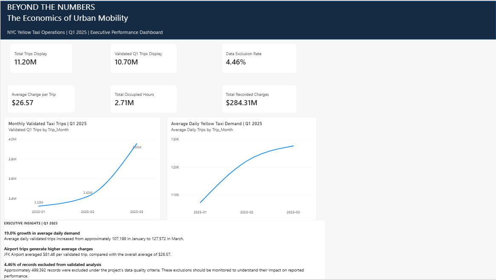
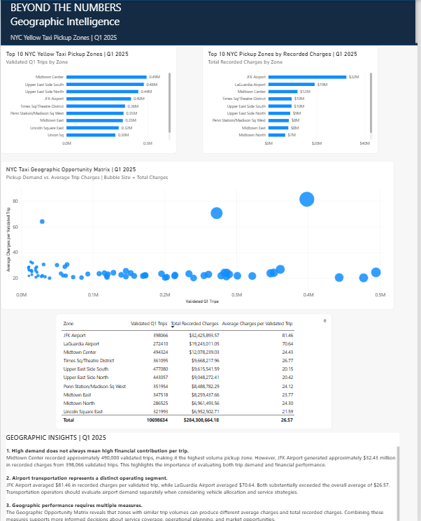

# Beyond the Numbers: The Economics of Urban Mobility

### NYC Yellow Taxi Operations | Q1 2025
**Business Intelligence and Operational Analytics Portfolio Project**

## Project Overview

This project analyzes New York City yellow taxi operations during the first quarter of 2025 using Microsoft Power BI. The objective is to transform transportation data into actionable business intelligence by examining passenger demand, revenue performance, geographic activity, operational efficiency, and data quality.

The analysis demonstrates how business intelligence can help organizations identify trends, evaluate performance, and make informed operational decisions.

## Business Questions

This project explores five questions:

1. How did yellow taxi demand change throughout Q1 2025?
2. Which pickup locations generated the greatest trip volume and recorded charges?
3. How did average trip duration and distance change over time?
4. What opportunities exist to improve vehicle deployment and operational efficiency?
5. How might data quality exclusions affect confidence in reported performance?

## Dashboard Overview

### 1. Executive Overview

Provides an overview of validated trips, recorded charges, average charges, demand trends, and data quality.

**Key findings:**
- 10.70 million validated trips
- $284.31 million in total recorded charges
- $26.57 average charge per trip
- Approximately 19% growth in average daily demand between January and March
- 4.46% of records excluded based on project data quality criteria

### 2. Geographic Intelligence

Examines pickup activity and recorded charges across NYC taxi zones, using comparative charts and a geographic opportunity matrix.

**Key findings:**
- Midtown Center recorded approximately 490,000 validated trips, the highest pickup volume among the zones analyzed.
- JFK Airport generated approximately $32.43 million in recorded charges, substantially more than Midtown Center despite having fewer trips.
- Airport trips generated higher average charges, suggesting that demand volume alone does not fully explain financial contribution.

### 3. Operational Insights

Evaluates trip duration, trip distance, implied speed, and charges per occupied hour.

**Key findings:**
- Average trip duration: 15.20 minutes
- Average trip distance: 6.39 miles
- Implied average speed: 25.21 mph
- Recorded charges per occupied hour: $104.89
- Both average trip distance and duration increased between January and March.

## Strategic Recommendations

**Optimize vehicle deployment:** Evaluate staffing and vehicle availability in response to increasing demand.

**Evaluate airport service opportunities:** Consider both trip volume and average charges when assessing service coverage and potential revenue opportunities.

**Monitor operational efficiency:** Track changes in trip distance and duration to distinguish changing travel patterns from potential operational delays.

**Strengthen data quality:** Monitor excluded records and validation criteria to improve reporting reliability.

## Tools and Skills Demonstrated

- Microsoft Power BI Desktop
- Business intelligence dashboard development
- Data visualization and KPI reporting
- Geographic and operational analysis
- Trend analysis
- Data quality assessment
- Business performance interpretation
- Strategic recommendations and data storytelling

## Project Scope

This portfolio project uses Q1 2025 NYC yellow taxi trip data. Findings are descriptive and should not be interpreted as causal conclusions or forecasts.

## Author

**Courtney Bynum**

MS in Data Analytics Candidate | Business Intelligence and Reporting

[LinkedIn](https://www.linkedin.com/in/courtney-bynum-579a73445/)
